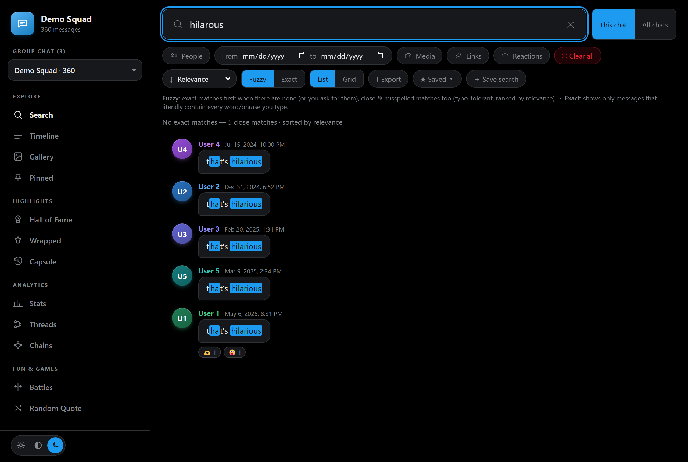
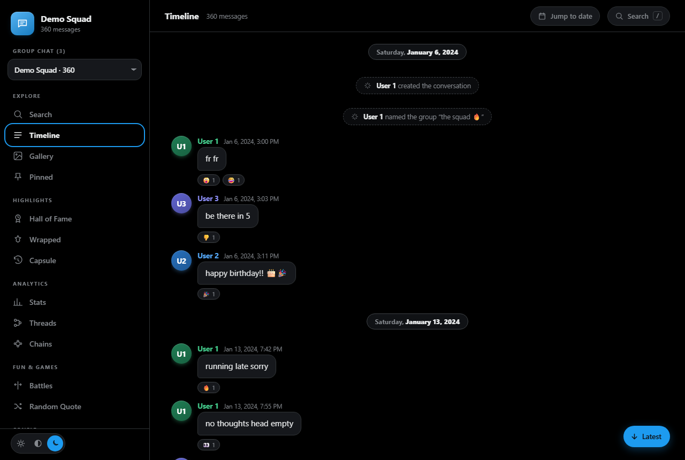
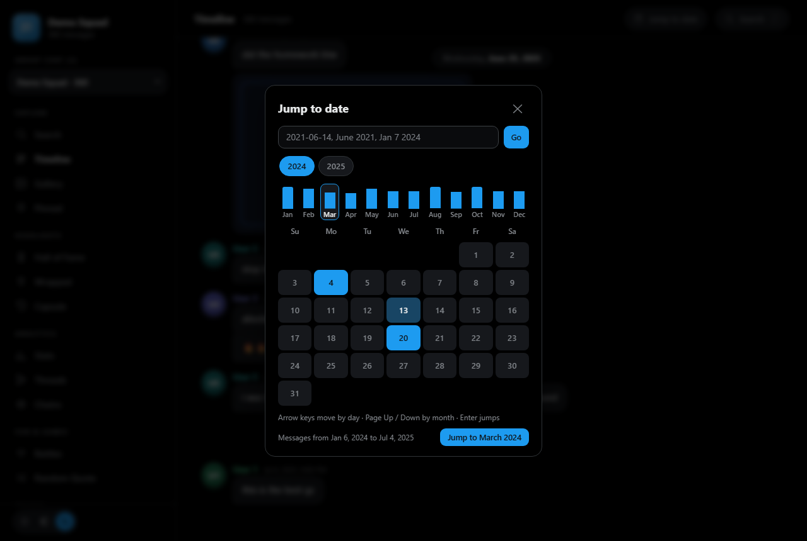
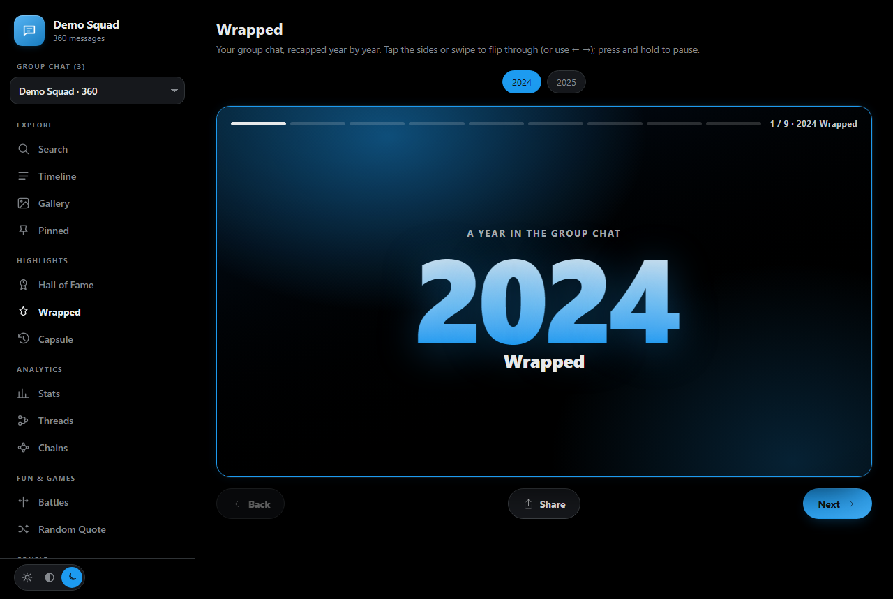
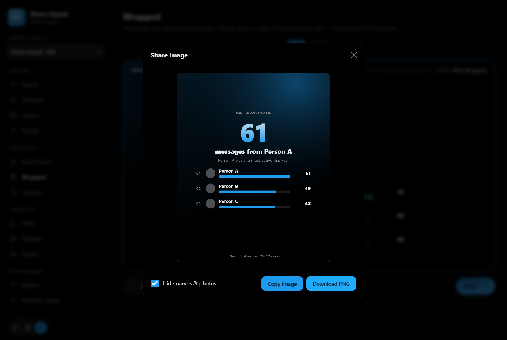

# Group Chat Archive

[](https://github.com/yib7/twitter_GC_archival/actions/workflows/ci.yml)

A dependency-free, fully offline browser for Twitter/X group chat (group DM)
exports. Drop in your export, run one build script, and explore years of group
history with fuzzy search, a virtual timeline, a media gallery, year-in-review
"Wrapped" slideshows, leaderboards, and more. No server, no API keys, no
internet. Have several group chats? A picker switches between them.

> The repo ships with synthetic demo data. No real messages, names, or media
> are committed. Open `index.html` and you'll see a runnable demo built from
> `sample/data.sample.js`. Point it at your own export to see your real history (kept
> local and `.gitignore`d).

## Screenshots

All from the synthetic demo data (the wizard preview uses a synthetic test export).

<table>
<tr>
<td width="50%">



</td>
<td width="50%">


</td>
</tr>
<tr>
<td width="50%">



</td>
<td width="50%">



</td>
</tr>
<tr>
<td width="50%">



</td>
<td width="50%">



</td>
</tr>
<tr>
<td width="50%">


</td>
<td width="50%">


</td>
</tr>
</table>

---

## Features

- Search that shows exact matches first and falls back to typo-tolerant
  fuzzy matches (Fuse.js) when there are none; "+ Show close matches" adds
  them on demand, and the matched text is highlighted either way. Sorting,
  list/grid views, saved searches, and plain-text export of the results.
  Search also covers the text a link shows (its full and display URL).
  - Operators, typed in the box and shown as removable chips under it (click
    a chip or press Backspace on it to drop it):

    | Operator | Keeps messages… |
    | --- | --- |
    | `from:ann`, `from:"Ann Lee"` (alias `sender:`) | sent by that person. Matches display names and aliases; typing `from:` suggests people |
    | `has:photo` `has:video` `has:file` | with a photo, a video or another attachment |
    | `has:media` `has:link` `has:reacts` | with any media, a link, or reactions |
    | `is:pinned` | you bookmarked |
    | `after:2021-06` `before:2024` | from / through a date (see below) |
    | `"exact phrase"` | containing the phrase word for word, in Fuzzy mode too |
    | `-word`, `-"some phrase"` | without that word or phrase |

    Operators work with any script and accents (`from:Zoë`, `-café`).
  - **This chat / All chats**: All chats searches every group chat at once
    (exact matches), grouped by chat with a count and a "Search only <chat>"
    button on each group. Removed group chats and ignored people stay out.
  - **Keyboard**: `/` focuses the box. Once a result has focus, `j` / `↓` and
    `k` / `↑` move between results, `Enter` opens one, `c` shows its context
    and `b` bookmarks it.
  - **Command palette** (Cmd/Ctrl-K): besides commands, people and dates, it
    shows the five newest matching messages in this chat. "See all in Search"
    opens the full result list.
  - Dates in `before:`/`after:` can be a day (`2021-06-14`), a month
    (`2021-06`) or a year (`2021`), or a quoted natural date
    (`after:"June 2021"`, `before:"Jan 7 2024"`). Both are **inclusive** of the
    whole period they name, in your configured timezone, like the From/To
    filter: `after:2021-06` starts on June 1, 2021 and `before:2021-06` keeps
    all of June. `after:2024-01-07 before:2024-01-07` is exactly that day. A
    date that doesn't exist (`2023-02-30`) is ignored with a note in the result
    line instead of being rolled over to another day. Slashed dates are read
    month first (`6/14/2021`); a day-first one (`14/06/2021`) is ignored with a
    note to use `2021-06-14` or `Jun 14 2021`.
- Dates and every stats bucket follow your browser's timezone by default; any
  IANA zone (or UTC) can be picked in Settings.
- Multiple group chats: a conversation picker switches between every group in
  your export. Every view is scoped to the selected group.
- A virtual timeline that scrolls 100K+ messages smoothly, with inline system
  events (group created, renamed, joins, leaves). It opens at the newest
  message, remembers your reading position per conversation, and has a
  "Latest" button plus Home / End for the oldest / newest message.
- Jump to any date from a calendar heatmap (year / month volume strips and a
  keyboard-browsable month of days) or the Cmd/Ctrl-K palette, which both
  accept natural dates ("June 2021", "Jan 7 2024") and say plainly when a date
  doesn't exist or falls outside the archive.
- Deep links: the address bar tracks the view, conversation and jumped-to
  message by id only, so Back / Forward work across views and jumps (also
  from `file://`), and "Link" on a message copies an ids-only link to it (from
  `file://` just the `#…` part, so your local path isn't shared). Your
  search text never goes in the URL (only the All chats switch does, as
  `&s=all`); Back / Forward and reload restore it from the tab's history state.
- Gallery of every photo and video, with a lightbox.
- Reactions render inline under each message, including custom emoji
  reactions shown as the actual glyph rather than a generic placeholder.
- Hall of Fame: most-reacted messages, podium and leaderboards by year.
- Wrapped, a year-in-review story: tap or swipe between slides, hold to
  pause, with backdrops mixed from your accent colour.
- Stats covering per-person activity, word clouds, milestones, busiest hours,
  and superlatives.
- Threads, Chains, and Battles for playful analytics and head-to-head.
- A Pinned view that collects bookmarked messages from every group chat, a
  Cmd/Ctrl-K command palette, a Time Capsule ("on this day"), Random Quote,
  and context-peek.
- Share cards: save any message, Hall of Fame entry or Wrapped slide as a
  PNG in your theme, fully offline, with an optional "Hide names & photos"
  that swaps names, @handles and photos for Person A/B/C. Check the preview
  before you share: a name that is also a common word (a lowercase "will",
  say) may be left in the message text. A one-word name that is a common
  word or one letter ("Will", "U") goes the other way: that word is hidden
  everywhere, so a line can read "I Person A go". A possessive name hides
  its stem too: someone named "Dad's Phone" also hides "Dad".
- A setup wizard that takes the unzipped archive folder, shows a read-only
  preview of what it found (chats, counts, dates, people, media, plain
  warnings) before writing anything, and later merges a newer export into the
  archive without losing names, photos or removals. Builds stream, so a
  ~600 MB export imports.
- Theming: three modes (Light, Dim, and Lights-out, a black-and-blue default),
  with a customizable accent, adjustable density, and a theme shuffle. All
  preferences are saved to `localStorage`.
- A responsive mobile layout (≤760px): a top app bar, a 5-tab bottom bar
  (Search / Timeline / Gallery / Stats / More), and a bottom sheet for the
  remaining views.

---

## Requirements

- **To browse an archive (the demo included):** a modern browser. Nothing to
  install and no internet connection. The test suite runs in Chromium, so
  Chrome and Edge are the tested browsers.
- **To import your own export:** [Node.js](https://nodejs.org) 22.13 or newer
  for the setup wizard. CI tests Node 22.13.0 and Node 24; Node 23 and anything
  older than 22.13 are not supported, and the double-click launchers say so
  instead of starting. The wizard uses only Node's built-in modules, so there
  is nothing to `npm install`.
- **Operating system:** Windows, macOS or Linux. The wizard's Browse buttons
  open native file dialogs on Windows only; on macOS and Linux you paste the
  folder path instead.
- No account, no API key, and nothing is uploaded anywhere.

## Quick start (demo, zero real data)

**Step 1.** Get the code:

```bash
git clone https://github.com/yib7/twitter_GC_archival.git
cd twitter_GC_archival
```

(No git? On the GitHub page click **Code → Download ZIP** and extract it. If
you'll run any commands below, open a terminal in the extracted folder.)

**Step 2.** Open `index.html` from the project folder in your browser
(double-click it).

You'll see the synthetic demo: three group chats, 660 messages over about 18
months. The demo needs no Node and no server. Over `file://` the browser
console shows a few not-found lines: the page looking for your own archive
files, which the demo doesn't have. They are harmless.

---

## Using your own export

**Step 1.** Request your archive from X (Settings → Your account → Download an
archive of your data). When X says it's ready, download and unzip it. The wizard
reads these three from it and ignores the rest (1:1 DMs included; this tool is
group chats only):

- `direct-messages-group.js`: group chat conversations (full message content)
- `direct-message-group-headers.js`: group metadata that completes the
  participant roster and join/leave/name events
- `direct_messages_group_media/`: group chat media (photos and videos)

**Step 2.** Start the setup wizard from the project folder:

| OS | Do this |
| --- | --- |
| Windows | Double-click `start-setup.cmd` |
| macOS | Double-click `start-setup.command` |
| Linux | Run `sh start-setup.command` in a terminal |

The launcher checks your Node.js version, starts the local server and opens
the wizard in your browser. The server stops by itself about 20 seconds after
you close the last tab it opened (the wizard or the archive).

The first time you open a launcher from a downloaded ZIP, your system may stop
it. macOS may refuse the double-click: open System Settings → Privacy &
Security and click **Open Anyway**, or run `sh start-setup.command` in
Terminal. Windows may ask you to confirm running `start-setup.cmd`.

**Step 3.** On the wizard's first step, click **Browse…** next to **Archive
folder** and pick any file in your unzipped archive (for example
`Your archive.html`); on macOS and Linux, paste the folder's path instead.
Click **Check export**, read the preview (group chats, message counts, dates,
people, photos and videos, and any warnings such as missing part files), then
click **Build archive**. A progress bar shows the media copy.

**Step 4** *(optional: click **Next** twice to skip it; you can name people
later in the viewer's People tab)*. After the build the wizard moves on to the
group: set its name and photo and click **Next** (with several group chats, pick
each one from **Which group chat**). Then name each person (their cards show
sample messages and media to tell them apart), mark which one is you, and click
**Next**.

**Step 5.** Click **Save & finish**, then **Open your archive →**. From now on,
double-click `index.html` whenever you want to read it; the server is only
needed to run the wizard again.

Everything the wizard writes lands in one git-ignored folder, `personal_data/`
(`config.json`, the built `data.js`, `local.js`, the copied raw export under
`source/`, copied `media/`, and `pfps/`). Each build keeps the previous archive
as `data.js.bak`. Removing a group chat or a person (the wizard asks first, with
counts) rebuilds the archive without their messages, keeps those messages in
`personal_data/.removed/messages.js` and moves their media to
`personal_data/.removed/`, so un-removing brings them back (even after a merge
with a newer export that no longer has them). Start over erases all of it.

> **Adding a newer export later** *(optional)*. Run the launcher again (Step 2),
> click **Add a newer export** on the wizard's first step, pick the new archive,
> and check the preview (what your archive already has, what the export adds).
> **Merge into archive** keeps your current archive as the baseline and adds the
> new messages (deduplicated by message id), so messages only in the older
> export stay. Names, photos, group names, "me" and removed people are kept, and
> `data.js.bak` is the archive as it was before the merge. Media already in the
> archive is never replaced. An export with no group messages can't be merged,
> and one older than your archive (or one it already has) needs an extra tick:
> the archive keeps its newer copies of messages it already has (reactions from
> both are kept). To just edit names, use **Continue**.

Prefer a terminal to the launcher? `npm start` runs the same server (no
`npm install` needed), but it doesn't open the browser or stop by itself: open
`http://localhost:8765/setup.html` and press Ctrl+C when you're done.

> **Videos won't play from `index.html`** *(only if that happens)*. Some
> browsers block video over `file://`. Run `npm start` and read the archive at
> `http://localhost:8765` instead.

### Environment variables

None are needed. Three optional ones change how the server and the build run.
Set them in the shell that starts the server; nothing reads a `.env` file.

| Variable | Default | Effect |
|----------|---------|--------|
| `GCA_PORT` | `8765` | Port for the local server. Change it if 8765 is already taken. |
| `GCA_PERSONAL` | `personal_data/` in the project folder | Folder for your archive and the wizard's files. Use an absolute path **outside** the project folder: only `personal_data*/` is git-ignored, so a folder inside the repo under another name would let `git add .` commit your real names and photos. |
| `GCA_DEBUG` | unset | `1` prints the stack trace when a build fails unexpectedly, for bug reports. |

```bash
GCA_PORT=9000 npm start           # macOS / Linux
$env:GCA_PORT=9000; npm start     # Windows PowerShell
```

The switches the test suite uses are listed under Testing in
[docs/ARCHITECTURE.md](docs/ARCHITECTURE.md#testing).

### Naming participants

X exports contain only numeric user IDs, so everyone shows as User 1, User 2,
and so on by default. The setup wizard (above) is the easiest way to name
everyone. You can always edit later in the People tab: rename, pick a color,
upload a profile picture, and mark "This is me", all saved to `localStorage`
(works from `file://`, no server). For a permanent local mapping you can also
hand-edit `personal_data/local.js` (`window.LOCAL_NAMES` / `LOCAL_PFPS` /
`LOCAL_ME` / `LOCAL_GC`).

---

## Development

Only needed to run the tests or change the code; the app itself installs
nothing. Run the steps in the project folder (see Quick start, Step 1). It
needs the same Node.js 22.13 or newer (`.nvmrc` pins 24, the version CI runs on
every OS).

**Step 1.** Install the dev tools at the exact versions in `package-lock.json`:

```bash
npm ci
```

**Step 2.** Download the headless Chromium the browser tests drive (one time):

```bash
npx playwright install chromium
```

**Step 3.** Run the unit tests, the smoke test and the linter:

```bash
npm test
npm run lint
```

`npm run test:e2e` runs the full browser suite (several minutes).
`node scripts/make-sample.js` regenerates the demo in `sample/`; the output is
identical on every run, and CI fails if the committed copy differs.

---

## Demo

A quick tour through search (a fuzzy match, then operators across All chats), the
timeline and its date calendar, the media gallery, Hall of Fame, the Wrapped
recap, and the stats dashboard (synthetic demo data):


---

## Data schema

`personal_data/data.js` / `sample/data.sample.js` define one global:

```js
window.CHAT_DATA = {
  generatedAt: "ISO",
  ignoredUsers?: [ids], ignoredGroups?: [ids],     // what the build left out
  conversations: [
    {
      id, type: "group", title, participants: [ids], count,
      msgs:  [ { i, s, t, x, u?, m?, k?, mx?, r? } ], // id, sender, time(ms), text, urls,
                                                      // media, kind, more media, reactions
      events:[ { t, type, ... } ]                  // name/join/leave/create
    },
    ...
  ]
}
```

The viewer also accepts the older single-conversation shape
(`{ conversationId, msgs, events }`) for backward compatibility.

Private builds can omit known bad/export-only users by adding an
`ignoredUsers: ["user-id"]` array to `personal_data/config.json` before running
the wizard build, or by setting `window.LOCAL_IGNORED_USERS` in a gitignored
local override.

---

## Project layout

```
index.html          app shell + script loading
start-setup.cmd     double-click launchers for the wizard (Windows / macOS)
start-setup.command
src/app.js          all UI logic (vanilla JS, no framework)
src/shared-core.js  helpers shared by the viewer, the wizard and the build
src/theme-boot.js   applies the saved theme before first paint
src/keepalive.js    lets the launcher's server exit once its pages close
src/styles.css      theme tokens + app styles (Light / Dim / Lights out)
src/setup.html      first-run setup wizard page (the server serves it at /setup.html)
src/setup.js        setup-wizard logic
src/setup.css       setup-wizard styles
src/vendor/         Fuse.js (Apache-2.0) + Chart.js (MIT), vendored, with licenses
scripts/build.js    config -> personal_data/data.js  (wizard-driven, merge-aware)
scripts/build-core.js    pure archive-assembly logic used by build.js
scripts/make-sample.js   synthetic demo generator -> sample/
scripts/server.js   static server + setup-wizard API (range requests for video)
scripts/server-core.js   pure server helpers (path allowlist, Host/Origin/Sec-Fetch guards)
scripts/fs-io.js    streaming export readers + atomic writes
sample/             committed synthetic demo data (data.sample.js) + placeholder photos
tests/              node:test units (*.test.js) + Playwright specs (*.spec.js)
docs/               architecture, security, changelog, credits, screenshots
personal_data/      (git-ignored) wizard output: config.json, data.js(.bak), local.js,
                    source/, media/, pfps/, .removed/ (all your real, private data in one place)
```

Built with [Fuse.js](https://www.fusejs.io/) (Apache-2.0) and
[Chart.js](https://www.chartjs.org/) (MIT), both vendored under `src/vendor/`. Full
attribution is in [docs/CREDITS.md](docs/CREDITS.md).

For how the raw export, the build step, and the viewer fit together, see
[docs/ARCHITECTURE.md](docs/ARCHITECTURE.md).

---

## Limitations

- Group chats only — 1:1 DM exports aren't parsed (X ships them in a separate
  file this tool doesn't read).
- Single-user, local-only: no accounts or sync. Everything you edit in-app
  (names, photos, bookmarks) lives in this browser's `localStorage` unless you
  back it up yourself.
- Native Browse-button file dialogs are Windows-only; macOS/Linux users paste
  file/folder paths into the wizard by hand.
- Load-tested with synthetic data up to ~130K messages; hasn't been run
  against a real export at that scale, and custom-emoji reaction rendering
  trusts a documented X export field name that hasn't been independently
  re-verified against a real archive.

What's next: native macOS/Linux file-picker dialogs, and confirming that
field name against a real export.

---

## Privacy & security

This repository is designed to be published without any private data. Real
messages, media, profile pictures, names, and packaged archives are listed in
[`.gitignore`](.gitignore). The only data committed is the fully synthetic
sample.

Both pages carry a strict Content-Security-Policy in a `<meta>` tag
(`script-src 'self'`, no inline scripts), which the browser enforces over
`file://` as well. When you run the local setup server (`scripts/server.js`),
it adds a fresh per-response nonce for the one config script it injects, and
sends every page with `X-Frame-Options: DENY` and a `frame-ancestors 'none'`
CSP header so no other site can frame them. What it checks, and where:

- **Every request:** the `Host` header must name this loopback server, which
  stops DNS rebinding.
- **Every reply** carries `Cross-Origin-Resource-Policy: same-origin`, so a
  web page on another site can't load `data.js`, your names, media or photos
  through a `<script>`, `` or `<video>` tag and read them. When the
  browser also says (with `Sec-Fetch-Site`) that another site asked for one of
  those private files, the server refuses it with `403`.
- **Routes that change files or open a dialog** (build, save, Start over, the
  file pickers) also need an `Origin`/`Referer` that is this server or absent.
  Every setup route, read-only ones included, is refused when
  `Sec-Fetch-Site` says another site sent it, or when its `Origin` or
  `Referer` names another site (for browsers that don't send
  `Sec-Fetch-Site`, such as Safari before 16.4). The
  native file pickers also need a per-run token that only the setup page
  receives.

See [docs/ARCHITECTURE.md](docs/ARCHITECTURE.md) for details. The server is
not needed for daily use — the built archive runs from `file://`.
