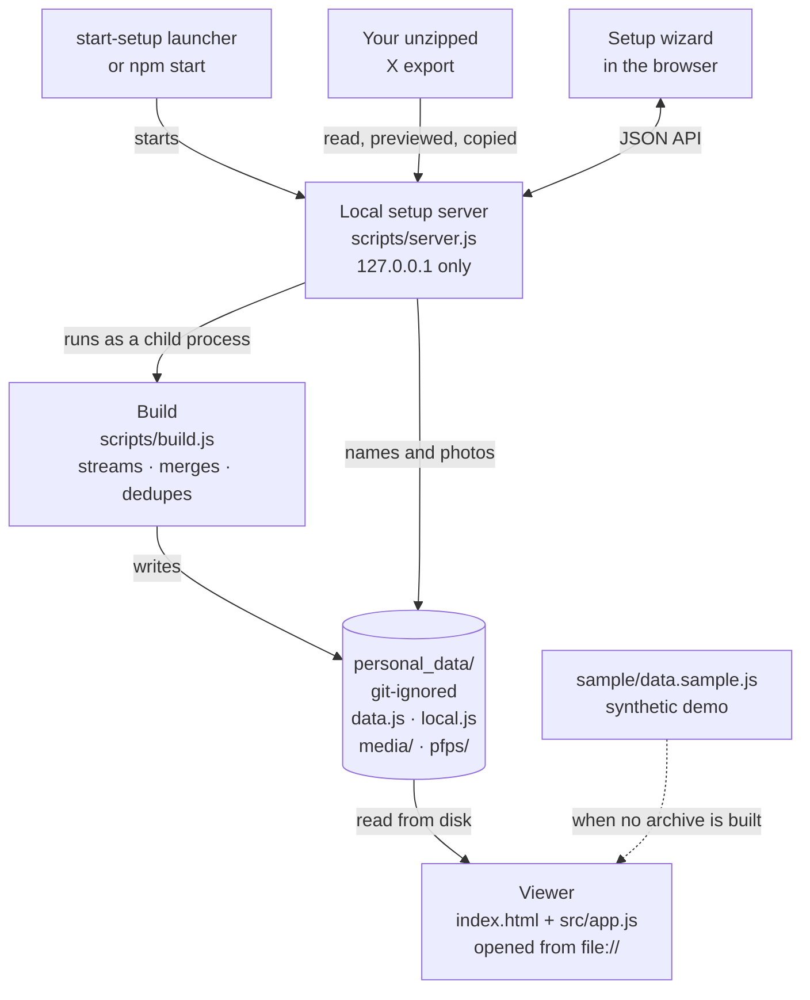

# Group Chat Archive

[](https://github.com/yib7/twitter_GC_archival/actions/workflows/ci.yml)

An offline browser for Twitter/X group chat (group DM) exports. Search,
read and chart years of group history from one `index.html` opened straight
from disk.

- **Runs from `file://`.** Vanilla JavaScript, no framework, no front-end
  build step, and no runtime npm dependencies (Fuse.js and Chart.js are
  vendored). A strict Content-Security-Policy, and nothing is sent over the
  internet.
- **Fast at 100K+ messages.** A virtualized timeline, exact-first search with
  a prefiltered fuzzy fallback, and Stats computed in time-sliced passes.
  CI holds search, Stats and Wrapped to timing budgets on a 120K-message
  synthetic archive.
- **Streaming import.** A local setup wizard previews an export read-only,
  then builds it. The build streams, so a ~600 MB export imports, and a newer
  export merges in, deduplicated by message id.
- **A locked-down local server.** Needed only for setup, it listens on
  `127.0.0.1` only and checks `Host`, `Origin` and `Sec-Fetch-Site` so other websites can't
  read or change your archive. Node built-ins only.
- **Tested.** About 690 unit tests and 620 Playwright browser tests,
  including keyboard and colour-contrast audits in all three themes. CI runs
  them on Windows, macOS and Linux.

Reading an archive needs only a browser: no server, no account, no API key,
no internet. Several group chats in one export? A picker switches between them.

> The repo ships with synthetic demo data. No real messages, names, or media
> are committed. Open `index.html` and you'll see a runnable demo built from
> `sample/data.sample.js`. Point it at your own export to see your real history (kept
> local and `.gitignore`d).

## Screenshots

All from the synthetic demo data (the wizard preview uses a synthetic test export).

<table>
<tr>
<td width="50%">


</td>
<td width="50%">


</td>
</tr>
<tr>
<td width="50%">


</td>
<td width="50%">


</td>
</tr>
</table>

---

## Features

- **Search.** Exact matches first, typo-tolerant fuzzy matches (Fuse.js)
  when there are none or on request, with the matched text highlighted.
  Operators such as `from:`, `has:photo`, `after:2021-06` and `-word` show as
  removable chips. Sorting, list/grid views, saved searches and plain-text
  export. Covers link text too (full and display URLs).
- **All chats.** Search every group chat at once, grouped by chat, with a
  "Search only <chat>" button on each group.
- **Keyboard.** `/` focuses search; `j` / `k` move through results, `Enter`
  opens one, `c` shows its context, `b` bookmarks it. Cmd/Ctrl-K opens a
  command palette with commands, people, dates and matching messages.
- **Timeline.** Virtualized, smooth at 100K+ messages, with inline system
  events (created, renamed, joins, leaves). Opens at the newest message and
  remembers your place per conversation.
- **Jump to any date** from a calendar heatmap or the palette, both reading
  natural dates ("June 2021", "Jan 7 2024").
- **Deep links.** The address bar tracks view, chat and message by id only,
  so Back / Forward work, even from `file://`. Your search text never goes in
  the URL.
- **Gallery** of every photo and video, with a lightbox. Reactions render
  under each message, custom emoji included.
- **Hall of Fame** (most-reacted messages, podium, yearly leaderboards) and
  **Wrapped**, a tap-through year-in-review story.
- **Stats:** per-person activity, word clouds, milestones, busiest hours and
  superlatives that say how they are measured. Plus **Threads**,
  **Chains** and head-to-head word **Battles**.
- **Pinned** messages across every chat, a Time Capsule ("on this day"),
  Random Quote and context peek.
- **Share cards.** Save a message, Hall of Fame entry or Wrapped slide as a
  PNG, offline, with an optional "Hide names & photos" (see the note below).
- **Setup wizard.** Previews what an export holds (chats, counts, dates,
  people, media, warnings) before writing anything, then builds the archive
  and lets you name people and groups. Merges a newer export later without
  losing names, photos or removals.
- **Time zones.** Dates and stats follow your browser's zone, or any IANA
  zone you pick in Settings.
- **Theming.** Light, Dim and Lights-out (a black-and-blue default), with a
  custom accent, density and a theme shuffle, saved in `localStorage`.
- **Mobile layout** (≤760px): top app bar, 5-tab bottom bar and a bottom
  sheet for the other views.
- **Accessible.** Keyboard-reachable controls with a visible focus ring and
  screen-reader labels, dialogs that hold focus, and WCAG AA text contrast in
  all three themes.

> **Hiding names on share cards** is word-based, so check the preview before
> you share. A name that is also a common word (a lowercase "will") may stay
> in the text. A one-word name that is a common word or one letter ("Will",
> "U") is hidden everywhere, so a line can read "I Person A go". A possessive
> name hides its stem too: "Dad's Phone" also hides "Dad".

<details>
<summary><strong>Search operators and date rules</strong></summary>

Operators are typed in the box and shown as removable chips under it (click
a chip or press Backspace on it to drop it):

| Operator | Keeps messages… |
| --- | --- |
| `from:ann`, `from:"Ann Lee"` (alias `sender:`) | sent by that person. Matches display names and aliases; typing `from:` suggests people |
| `has:photo` `has:video` `has:file` | with a photo, a video or another attachment |
| `has:media` `has:link` `has:reacts` | with any media, a link, or reactions |
| `is:pinned` | you bookmarked |
| `after:2021-06` `before:2024` | from / through a date (see below) |
| `"exact phrase"` | containing the phrase word for word, in Fuzzy mode too |
| `-word`, `-"some phrase"` | without that word or phrase |

Operators work with any script and accents (`from:Zoë`, `-café`).

All chats shows exact matches only. Removed group chats and ignored people
stay out of it.

Dates in `before:`/`after:` can be a day (`2021-06-14`), a month (`2021-06`),
a year (`2021`), or a quoted natural date (`after:"June 2021"`).

- Both are **inclusive** of the whole period they name, in your configured
  timezone: `after:2021-06` starts on June 1, 2021 and `before:2021-06` keeps
  all of June. `after:2024-01-07 before:2024-01-07` is exactly that day.
- A date that doesn't exist (`2023-02-30`) is ignored with a note, never
  rolled over to another day.
- Slashed dates are read month first (`6/14/2021`). A day-first one
  (`14/06/2021`) is ignored with a note to use `2021-06-14` or `Jun 14 2021`.

</details>

---

## How it works



1. The launcher starts a small Node server and opens the wizard.
2. The wizard previews the export, then the server copies it and runs the build.
3. The build writes `personal_data/data.js`; the wizard saves names and photos.
4. From then on the viewer opens from disk. The server is only for setup.

More detail in [docs/ARCHITECTURE.md](docs/ARCHITECTURE.md).

---

## Requirements

- **To browse an archive (the demo included):** a modern browser. Nothing to
  install and no internet connection. The browser tests run in Chromium only
  (Playwright); Firefox and Safari are not tested.
- **To import your own export:** [Node.js](https://nodejs.org) 22.13 or newer
  for the setup wizard. CI tests Node 22.13.0 and Node 24; Node 23 and anything
  older than 22.13 are not supported, and the double-click launchers say so
  instead of starting. The wizard uses only Node's built-in modules, so there
  is nothing to `npm install`.
- **Operating system:** Windows, macOS or Linux. The wizard's Browse buttons
  open native file dialogs on Windows only; on macOS and Linux you paste the
  folder path instead.
- No account, no API key, and nothing is uploaded anywhere.

## Quick start (demo, zero real data)

**Step 1.** Get the code:

```bash
git clone https://github.com/yib7/twitter_GC_archival.git
cd twitter_GC_archival
```

(No git? On the GitHub page click **Code → Download ZIP** and extract it. If
you'll run any commands below, open a terminal in the extracted folder.)

**Step 2.** Open `index.html` from the project folder in your browser
(double-click it).

You'll see the synthetic demo: three group chats, 660 messages over about 18
months. The demo needs no Node and no server. Over `file://` the browser
console shows a few not-found lines: the page looking for your own archive
files, which the demo doesn't have. They are harmless.

---

## Using your own export

**Step 1.** Request your archive from X (Settings → Your account → Download an
archive of your data). When X says it's ready, download and unzip it. The wizard
reads these three from it and ignores the rest (1:1 DMs included; this tool is
group chats only):

- `direct-messages-group.js`: group chat conversations (full message content)
- `direct-message-group-headers.js`: group metadata that completes the
  participant roster and join/leave/name events
- `direct_messages_group_media/`: group chat media (photos and videos)

**Step 2.** Start the setup wizard from the project folder:

| OS | Do this |
| --- | --- |
| Windows | Double-click `start-setup.cmd` |
| macOS | Double-click `start-setup.command` |
| Linux | Run `sh start-setup.command` in a terminal |

The launcher checks your Node.js version, starts the local server and opens
the wizard in your browser. The server stops by itself about 20 seconds after
you close the last tab it opened (the wizard or the archive).

The first time you open a launcher from a downloaded ZIP, your system may stop
it. macOS may refuse the double-click: open System Settings → Privacy &
Security and click **Open Anyway**, or run `sh start-setup.command` in
Terminal. Windows may ask you to confirm running `start-setup.cmd`.

**Step 3.** On the wizard's first step, click **Browse…** next to **Archive
folder** and pick any file in your unzipped archive (for example
`Your archive.html`); on macOS and Linux, paste the folder's path instead.
Click **Check export**, read the preview (group chats, message counts, dates,
people, photos and videos, and any warnings such as missing part files), then
click **Build archive**. A progress bar shows the media copy.

**Step 4** *(optional: click **Next** twice to skip it; you can name people
later in the viewer's People tab)*. After the build the wizard moves on to the
group: set its name and photo and click **Next** (with several group chats, pick
each one from **Which group chat**). Then name each person (their cards show
sample messages and media to tell them apart), mark which one is you, and click
**Next**.

**Step 5.** Click **Save & finish**, then **Open your archive →**. From now on,
double-click `index.html` whenever you want to read it; the server is only
needed to run the wizard again.

Everything the wizard writes lands in one git-ignored folder, `personal_data/`
(`config.json`, the built `data.js`, `local.js`, the copied raw export under
`source/`, copied `media/`, and `pfps/`). Each build keeps the previous archive
as `data.js.bak`. Removing a group chat or a person (the wizard asks first, with
counts) rebuilds the archive without their messages, keeps those messages in
`personal_data/.removed/messages.js` and moves their media to
`personal_data/.removed/`, so un-removing brings them back (even after a merge
with a newer export that no longer has them). Start over erases all of it.

> **Adding a newer export later** *(optional)*. Run the launcher again (Step 2),
> click **Add a newer export** on the wizard's first step, pick the new archive,
> and check the preview (what your archive already has, what the export adds).
> **Merge into archive** keeps your current archive as the baseline and adds the
> new messages (deduplicated by message id), so messages only in the older
> export stay. Names, photos, group names, "me" and removed people are kept, and
> `data.js.bak` is the archive as it was before the merge. Media already in the
> archive is never replaced. An export with no group messages can't be merged,
> and one older than your archive (or one it already has) needs an extra tick:
> the archive keeps its newer copies of messages it already has (reactions from
> both are kept). To just edit names, use **Continue**.

Prefer a terminal to the launcher? `npm start` runs the same server (no
`npm install` needed), but it doesn't open the browser or stop by itself: open
`http://localhost:8765/setup.html` and press Ctrl+C when you're done.

> **Videos won't play from `index.html`** *(only if that happens)*. Some
> browsers block video over `file://`. Run `npm start` and read the archive at
> `http://localhost:8765` instead.

### Environment variables

None are needed. Three optional ones change how the server and the build run.
Set them in the shell that starts the server; nothing reads a `.env` file.

| Variable | Default | Effect |
|----------|---------|--------|
| `GCA_PORT` | `8765` | Port for the local server. Change it if 8765 is already taken. |
| `GCA_PERSONAL` | `personal_data/` in the project folder | Folder for your archive and the wizard's files. Use an absolute path **outside** the project folder: only `personal_data*/` is git-ignored, so a folder inside the repo under another name would let `git add .` commit your real names and photos. |
| `GCA_DEBUG` | unset | `1` prints the stack trace when a build fails unexpectedly, for bug reports. |

```bash
GCA_PORT=9000 npm start           # macOS / Linux
$env:GCA_PORT=9000; npm start     # Windows PowerShell
```

The switches the test suite uses are listed under Testing in
[docs/ARCHITECTURE.md](docs/ARCHITECTURE.md#testing).

### Naming participants

X exports contain only numeric user IDs, so everyone shows as User 1, User 2,
and so on by default. The setup wizard (above) is the easiest way to name
everyone. You can always edit later in the People tab: rename, pick a color,
upload a profile picture, and mark "This is me", all saved to `localStorage`
(works from `file://`, no server). For a permanent local mapping you can also
hand-edit `personal_data/local.js` (`window.LOCAL_NAMES` / `LOCAL_PFPS` /
`LOCAL_ME` / `LOCAL_GC`).

---

## Development

Only needed to run the tests or change the code; the app itself installs
nothing. Run the steps in the project folder (see Quick start, Step 1). It
needs the same Node.js 22.13 or newer (`.nvmrc` pins 24, the version CI runs on
every OS).

**Step 1.** Install the dev tools at the exact versions in `package-lock.json`:

```bash
npm ci
```

**Step 2.** Download the headless Chromium the browser tests drive (one time):

```bash
npx playwright install chromium
```

**Step 3.** Run the unit tests, the smoke test and the linter:

```bash
npm test
npm run lint
```

`npm run test:e2e` runs the full browser suite (several minutes).
`node scripts/make-sample.js` regenerates the demo in `sample/`; the output is
identical on every run, and CI fails if the committed copy differs.

---

## Demo

A quick tour through search (a fuzzy match, then operators across All chats), the
timeline and its date calendar, the media gallery, Hall of Fame, the Wrapped
recap, and the stats dashboard (synthetic demo data):


---

## Data schema

`personal_data/data.js` / `sample/data.sample.js` define one global:

```js
window.CHAT_DATA = {
  generatedAt: "ISO",
  ignoredUsers?: [ids], ignoredGroups?: [ids],     // what the build left out
  conversations: [
    {
      id, type: "group", title, participants: [ids], count,
      msgs:  [ { i, s, t, x, u?, m?, k?, mx?, r? } ], // id, sender, time(ms), text, urls,
                                                      // media, kind, more media, reactions
      events:[ { t, type, ... } ]                  // name/join/leave/create
    },
    ...
  ]
}
```

The viewer also accepts the older single-conversation shape
(`{ conversationId, msgs, events }`) for backward compatibility.

Private builds can omit known bad/export-only users by adding an
`ignoredUsers: ["user-id"]` array to `personal_data/config.json` before running
the wizard build, or by setting `window.LOCAL_IGNORED_USERS` in a gitignored
local override.

---

## Project layout

```
index.html          app shell + script loading
start-setup.cmd     wizard launcher for Windows (double-click)
start-setup.command wizard launcher for macOS (double-click) and Linux (sh start-setup.command)
src/app.js          all UI logic (vanilla JS, no framework)
src/shared-core.js  helpers shared by the viewer, the wizard and the build
src/theme-boot.js   applies the saved theme before first paint
src/keepalive.js    lets the launcher's server exit once its pages close
src/styles.css      theme tokens + app styles (Light / Dim / Lights out)
src/setup.html      first-run setup wizard page (the server serves it at /setup.html)
src/setup.js        setup-wizard logic
src/setup.css       setup-wizard styles
src/vendor/         Fuse.js (Apache-2.0) + Chart.js (MIT), vendored, with licenses
scripts/build.js    config -> personal_data/data.js  (wizard-driven, merge-aware)
scripts/build-core.js    pure archive-assembly logic used by build.js
scripts/make-sample.js   synthetic demo generator -> sample/
scripts/server.js   static server + setup-wizard API (range requests for video)
scripts/server-core.js   pure server helpers (path allowlist, Host/Origin/Sec-Fetch guards)
scripts/fs-io.js    streaming export readers + atomic writes
sample/             committed synthetic demo data (data.sample.js) + placeholder photos
tests/              node:test units (*.test.js) + Playwright specs (*.spec.js)
docs/               architecture, security, changelog, credits, screenshots
personal_data/      (git-ignored) wizard output: config.json, data.js(.bak), local.js,
                    source/, media/, pfps/, .removed/ (all your real, private data in one place)
```

Built with [Fuse.js](https://www.fusejs.io/) (Apache-2.0) and
[Chart.js](https://www.chartjs.org/) (MIT), both vendored under `src/vendor/`. Full
attribution is in [docs/CREDITS.md](docs/CREDITS.md).

For how the raw export, the build step, and the viewer fit together, see
[docs/ARCHITECTURE.md](docs/ARCHITECTURE.md).

---

## Limitations

- **Not a hosted service.** One person, one machine: no accounts, no sync. What
  you edit in the viewer (names, photos, bookmarks) lives in this browser's
  `localStorage`; Settings → Export settings saves it to a file.
- **X/Twitter group chats only.** 1:1 DMs (a separate file in the export) and
  other platforms' exports aren't read.
- **Chromium is the only tested browser,** and the wizard's Browse dialogs are
  Windows-only (on macOS and Linux you paste the folder path).
- **Tested scale is synthetic:** timing budgets at 120K messages, a build of a
  ~600 MB export. No real export that large has been run, and custom-emoji
  reactions rely on an X field name (`emojiReaction`) not yet checked against
  a real archive.

What's next: native file pickers on macOS and Linux, a Firefox and WebKit run
in CI, and confirming that field name against a real export.

---

## Privacy & security

The repository is built to be published with no private data. Real messages,
media, photos, names and packaged archives are git-ignored
([`.gitignore`](.gitignore)). The only committed data is the synthetic sample.

- **Strict CSP.** Both pages set `script-src 'self'` with no inline scripts,
  enforced over `file://` too.
- **Loopback only.** The setup server listens on `127.0.0.1` and checks `Host`
  on every request, which stops DNS rebinding.
- **No cross-site reads.** Every reply carries
  `Cross-Origin-Resource-Policy: same-origin`, so another site can't load your
  data, media or photos with a `<script>`, `` or `<video>` tag.
- **Cross-site requests are refused.** `/api/` routes and private files return
  `403` when `Sec-Fetch-Site` says another site sent the request. `/api/`
  routes also check `Origin` and `Referer`.
- **File pickers need a token.** The native dialogs require a per-run token
  that only the setup page receives.
- **No framing.** Pages are sent with `X-Frame-Options: DENY`.

Full rules in [docs/ARCHITECTURE.md](docs/ARCHITECTURE.md). The server is not
needed for daily use: the built archive runs from `file://`.
