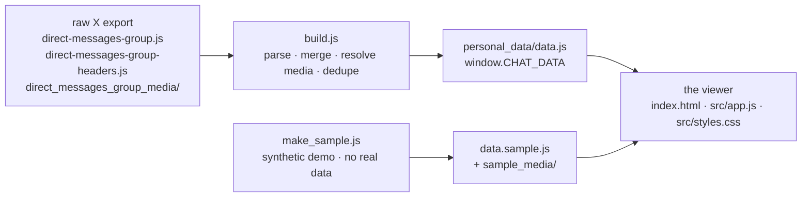

# Architecture: how the Group Chat Archive works

A short tour of the codebase for anyone reading or extending it. The whole thing
is vanilla JavaScript with two vendored libraries (Fuse.js, Chart.js) and no
build step for the front-end.

## The pipeline



For a public/demo run with no real data, `make_sample.js` substitutes for the
raw export: it synthesizes `data.sample.js` + `sample_media/` in the same schema
that the viewer reads.

### Setup wizard & `personal_data/`

First-run setup is a served page (`setup.html` + `src/setup.js` + `src/setup.css`)
backed by three small JSON endpoints in `scripts/server.js` (Node built-ins only).
It exists because a pure `file://` page can't write config or copy a multi-GB
media folder. The contract is **"UI collects config, Node builds"**: the wizard
gathers paths/names/photos and triggers `build.js` server-side.

All real, per-user data lands in one git-ignored folder:

```
personal_data/
  config.json   { sourceJs:[paths], headersJs, mediaDir, me, gcName, gcPhoto, names:{}, pfps:{} }
  data.js       built window.CHAT_DATA
  local.js      window.LOCAL_NAMES / LOCAL_PFPS / LOCAL_ME / LOCAL_GC{name,photo}
  source/       copied raw export .js (direct-messages-group.js + -headers.js)
  media/        copied group media (referenced by root-relative path)
  pfps/         gc.<ext> + <participantId>.<ext> profile images
```

`config.json` is the wizard↔build contract and the **only** way the build is
driven: `build.js` reads its `sourceJs` + `headersJs` + `mediaDir` and writes
`personal_data/data.js`. With no `config.json`, `build.js` exits and tells the
user to run the wizard. Media paths are emitted **relative to the project root**,
so they resolve regardless of where `data.js` sits.

Server endpoints:

| Endpoint | Role |
|----------|------|
| `GET /api/pick-file?for=group\|headers` · `GET /api/pick-folder` | Open a native Windows file/folder dialog (PowerShell `OpenFileDialog` / `FolderBrowserDialog`) and return the chosen absolute path, so users can browse instead of typing. `for` tailors the file dialog's title + filter. Falls back to manual entry off Windows. |
| `POST /api/source` | `{ groupJs, headersJs, mediaDir }` → validate (all three **required** and existing), copy both `.js` into `personal_data/source/` and media into `personal_data/media/`, write `config.json` (`sourceJs` = group file, `headersJs` = headers file), run `build.js`, return a summary. |
| `GET /api/parts` | Participants from the built data, each with up to 10 Twitter/X-link-free sample messages + a few shared-media paths. |
| `POST /api/identity` | `{ me, gcName, gcPhoto, names, pfps }` (images as data URLs) → write files into `personal_data/pfps/`, then `personal_data/local.js`. |

## Files

| File | Role |
|------|------|
| `scripts/build.js` | Node script and the filesystem shell around `build-core.js`. Wizard-driven (requires `personal_data/config.json`; exits otherwise): reads the export file(s), calls `assembleConversations()`, and writes `personal_data/data.js`. Merge-aware: re-reads the previous build as a baseline so history accumulates. Group-chats only, 1:1 DMs (id shape `a-b`) are skipped. |
| `scripts/build-core.js` | The pure archive-assembly logic (no filesystem I/O), so it can be unit-tested in isolation (`tests/build-core.test.js`). Folds **every** group `dmConversation` into a per-conversation accumulator, dedupes messages by id, resolves local media by the `{messageId}-…` filename convention, and, when the headers file is supplied, folds `direct-message-group-headers.js` (metadata only: it adds no messages but completes each conversation's participant roster and join/leave/name events). Also owns `collectParticipants` (used by the server's `/api/parts`) and `require()`s the shared `X_LINK` regex from `src/shared-core.js`. |
| `scripts/make_sample.js` | Node script. Deterministic synthetic-data generator → `data.sample.js` (3 group chats, ~130 messages, tagged `__sample`) plus placeholder SVG media/avatars. Zero real data. |
| `setup.html` · `src/setup.js` · `src/setup.css` | First-run setup wizard (served). Collects source paths, group name/photo, and per-participant names/pfps/"you", talking to the `scripts/server.js` API. |
| `index.html` | App shell + sidebar markup. Loads `src/theme-boot.js`, then `data.sample.js` first, then gitignored real data that overrides it (`data.js`, then `personal_data/data.js`), then name overrides (`names.local.js`, then `personal_data/local.js`), then `lib/`, then `src/shared-core.js`, then `src/app.js`. |
| `src/app.js` | The entire UI. See "Runtime model" below. |
| `src/shared-core.js` | Single source for the constants/helpers three consumers all need to agree on: `PALETTE` (avatar colors), `X_LINK` (Twitter/X link matcher), `hashId`, `initials`, `paletteColor`, plus the text-analysis definitions (emoji, tokenizer, stopwords, keywords, link platforms, `plural`) and the time index (see *Analytics definitions*). Dual-target, no bundler: a UMD-style wrapper sets `window.GCAShared` when loaded as a plain `<script>` (`index.html`/`setup.html`, before `app.js`/`setup.js`) and exports the same object via `module.exports` when `require()`d from Node (`scripts/build-core.js`). Replaces three previously-duplicated copies of the same constants; `tests/shared-core.test.js` asserts every consumer wires up this module and none re-declares its own copy. |
| `src/theme-boot.js` | Applies the saved `gca.theme` (light/dim/lightsout) to `<html data-theme>` before first paint, avoiding a flash of the wrong theme. Externalized into its own same-origin file (loaded first, in `<head>`, in both `index.html` and `setup.html`) rather than an inline `<script>` block, so the served-mode CSP's `script-src 'self'` needs no per-inline-script hash or `'unsafe-inline'`. No-op over `file://` (`localStorage` still works there; the CSP header simply isn't sent). |
| `src/styles.css` | App styles + the X design-token theme system: `html[data-theme]` blocks for Light, Dim, and Lights out. Accent, font size, and density stay JS-driven CSS variables. |
| `scripts/server.js` | Static file server with HTTP range support (for video), plus the setup-wizard API (`/api/source`, `/api/parts`, `/api/identity`). Not required for daily use, the app runs from `file://`. In served mode it also sends the CSP header (`script-src 'self' 'nonce-<random>'`, matched to a nonce injected into the response's inline theme/boot script tags) and enforces the Host/Origin guard below on every request. |
| `scripts/server-core.js` | Pure, side-effect-free server helpers (path allowlist `isServablePath`, `pfpFileName`, `isInsidePersonal`, `openerCommand`, idle-liveness, name merges), split out so the security-sensitive routing rules are unit-tested in isolation (`tests/server-core.test.js`), mirroring the `build.js` / `build-core.js` split. Also owns the **Host/Origin guard**: `isAllowedHost(hostHeader, port)` checks every request's `Host` header against a loopback-hostname allowlist (blocks DNS-rebinding — a malicious external DNS name that resolves to `127.0.0.1` — and any host/port mismatch); `isAllowedOrigin(originHeader, refererHeader, port)` additionally checks `Origin`/`Referer` on the state-changing routes in `server.js`'s `GUARDED` set (`/api/reset`, `/api/source`, `/api/identity`, `/api/pick-file`, `/api/pick-folder`), rejecting any cross-origin `POST` (CSRF). Both return `403` on failure; `tests/server-host-guard.test.js` and `tests/server-core.test.js` cover the malformed-header and DNS-rebind edge cases. |
| `src/keepalive.js` | Heartbeat pinged from `index.html`/`setup.html` while served over http(s): the double-click launcher starts the server with `--open`, and the server shuts itself down when the heartbeat goes quiet, so closing the browser also closes the stray command window. No-op over `file://`; harmless against a manually-started server. |
| `lib/` | Vendored Fuse.js (Apache-2.0) + Chart.js (MIT). |

## Data schema (`window.CHAT_DATA`)

```js
{
  generatedAt,
  conversations: [
    { id, type:"group", title, participants:[id], count,
      msgs:  [ { i, s, t, x, u?, m?, k?, r? } ],   // id, sender, time(ms), text,
                                                   //   urls, media-path, kind, reactions
      events:[ { t, type:"name"|"join"|"leave"|"create", ... } ] }
  ]
}
```
The viewer also accepts the legacy single-conversation shape
(`{ conversationId, msgs, events }`), `normalizeConvos()` wraps it into a
one-element `conversations` array.

## Runtime model (`app.js`)

`src/app.js` is one IIFE. The key design idea behind multi-group support:

- **`CONVOS`**: the full list of conversations (from `CHAT_DATA`).
- **Active-conversation state**: `CONV`, `MSGS`, `EVENTS`, `N`, `LOWER`
  (lowercased text cache), `ID2IDX`, `PARTS` (participants), `GENERIC`
  (`id → "User N"`). These are module-level `let`s that get **reassigned** when
  the conversation changes.
- **`activateConversation(id, rerender)`**: the switch point. It loads the
  conversation's messages into `MSGS`, rebuilds the search indexes
  (`rebuildIndexes()`), drops every derived cache and per-view state
  (`resetDerived()`), recomputes `PARTS`, assigns generic names, and (when
  `rerender`) refreshes the brand, the picker, the sparkline, and the current
  view.

Because all views read from the same module-level `MSGS`/`PARTS`/caches, they
become conversation-scoped "for free", switching simply swaps the data under
them and forces a re-render. The conversation picker (`renderConvPicker()`) is a
`<select>` in the sidebar, shown only when there is more than one group.

### Time index, Stats rendering and search at scale

- **`timeIndex()`** is the one zone-aware sweep over the active conversation:
  typed arrays parallel to `MSGS` (zoned day number, year, month, day of month,
  hour, minute, weekday, `year*12+month`), built lazily once per (conversation,
  timezone) by a memoized zone clock (`GCAShared.createZoneClock`: one `Intl`
  call per UTC day, bisection only on DST-transition days). **`timeAgg()`**
  caches the per-day / per-month / hour / weekday counts on top of it. Every
  analytics view reads these, and later features (per-person analytics, the
  calendar heatmap) should too. Both are dropped by `resetDerived()` and on a
  timezone change, and re-check `MSGS` identity and the zone, so a stale index
  is never served. The full field list is documented above `timeIndex()`.
- **Stats renders in two stages.** Stage 1 (overview, milestones, per-person
  bars, the four charts, the keyword-trend input) paints synchronously; the
  heavy sections (superlatives, reply latency, yapping, generosity, vocabulary,
  emojis, word cloud) show pulsing placeholders and are filled by time-sliced
  generator sweeps (~24 ms slices) after the first frame. A newer render cancels
  a pending stage 2, and `#view-stats` gets `data-ready="1"` when complete.
  Stats is not re-rendered while it is hidden; a conversation switch just
  empties it.
- **Search is exact-first.** The literal (AND of terms) match runs first; the
  Fuse.js typo-tolerant ranking runs only when that finds nothing, or when the
  user clicks "+ Show close matches" for the current query. Fuse is fed by a
  bigram (q-gram lemma) prefilter (`GCAShared.createBigramIndex` /
  `fuzzyCandidates`) that only drops messages Fuse could not match at its
  threshold, so results are identical to scanning the whole archive (a unit
  test proves it). The result list is windowed: 60-row pages far from the
  viewport are frozen at their height and emptied, then re-rendered on return.

### Analytics definitions

- **One text vocabulary.** `src/shared-core.js` owns every definition the
  analytics views count with: `extractEmojis` (whole emoji sequences),
  `tokenize` / `wordKey` / `wordKeys` / `countKeys` (one Unicode word
  tokenizer, whole-word matching), `isCloudWord` (stopwords), `KEYWORDS`
  (laugh, gratitude, slang, …) and `linkPlatform` (hostname-based). Stats,
  Wrapped, Word Battles and the keyword trend never keep their own regexes;
  `tests/text-analysis.test.js` pins the definitions.
- **People.** `PARTS` is every member of the conversation: senders by
  message count, then members who never posted (roster, reaction-only and
  join/leave ids). `nameOf()` / `GENERIC` give one display name and
  `personColor(id)` one colour (override or avatar hue) to every view.
- **Superlatives.** The `SUPERLATIVES` descriptor list (key, title, pool,
  `value`, `fmt`, `def`) is the only definition of each award. One sweep
  (`statsGen`) builds a per-person record; the awards are computed from it
  once into `STATS.awards`, which both the Stats grid and the profile badges
  render. Rate awards need `max(20, 1% of messages)` messages; a card is
  hidden when fewer than two people qualify, the best value is 0 or everyone
  ties, and a shared top value is shown as a tie.
- **Months are zero-filled** in `timeAgg().monthArr`, which the months chart,
  hero and sidebar sparklines and the keyword trend all read.
- **Charts follow the theme.** Charts are built through `makeChart()`, which
  colours ticks / grid from `--text-dim` / `--border` and datasets from the
  accent; `refreshChartTheme()` re-applies that to the open charts from
  `setTheme()` and `applyTheme()`.

Boot happens at the very end of the IIFE (after all `let`s are declared, so
`resetDerived()` doesn't hit a temporal-dead-zone) → `activateConversation()` →
`init()`.

### Names & avatars
The export has only numeric ids. Committed defaults are empty, so people render
as **User 1…N** (`GENERIC`, assigned per-conversation by message rank). Priority
in `nameOf()`: user-saved (`settings.names`, People tab → localStorage) →
`window.LOCAL_NAMES` (gitignored `local.js`) → `GENERIC` → `User <id4>`.
Profile pictures: `PFPS = { ...LOCAL_PFPS, ...settings.pfps }`, where in-app
uploads (People tab) are stored as data URLs in `settings.pfps` so editing works
from `file://` with no server. The group photo + name come from
`window.LOCAL_GC` / `settings.gcPhoto`/`gcName` (`updateBrand()`), and the
wizard's "this is you" marker is `window.LOCAL_ME` (a default for `settings.me`).

### First-run onboarding
The shipped demo (`data.sample.js`) carries a `__sample` flag; any real build
overrides `CHAT_DATA` without it. `app.js` reads this as `IS_SAMPLE` and shows a
dismissible onboarding overlay (`maybeShowOnboarding()`) when the demo is loaded,
or when real data is loaded but nobody is named/marked yet, linking to the setup
wizard or the People tab.

### Views (registered in `setView`)
Search, Timeline (virtualized), Gallery, Pinned, Hall of Fame, Wrapped, Capsule,
Stats, Threads, Chains, Battles, People, Settings, plus Random Quote and the
⌘K command palette.

### Mobile chrome (≤760px)
Below 760px the sidebar is replaced by the mock's mobile experience: a fixed
top app bar (brand mark + conversation picker + palette button), a 5-tab
bottom bar (Search / Timeline / Gallery / Stats / More), and a bottom "More"
sheet holding the remaining views. `initMobileChrome()` wires the tab bar,
sheet, and top-bar conversation `<select>`; `reflectMobileNav()` mirrors the
active view onto the tab bar (or lights "More" when the active view lives in
the sheet). Desktop and non-DOM contexts are unaffected; the whole layer is
`display:none` above the breakpoint.

### Local data
All viewer state (theme, names, profile pictures, bookmarks, saved searches)
lives in `localStorage` under `gca.*` keys.
