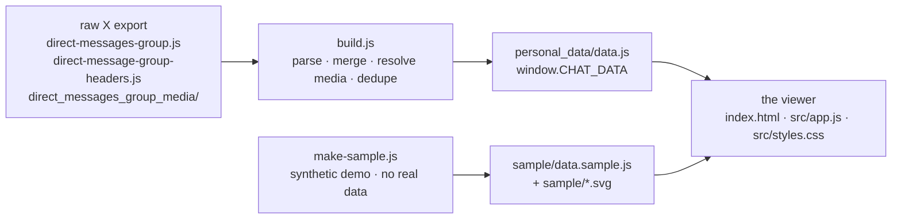

# Architecture: how the Group Chat Archive works

A short tour of the codebase for anyone reading or extending it. The whole thing
is vanilla JavaScript with two vendored libraries (Fuse.js, Chart.js) and no
build step for the front-end.

## The pipeline



For a public/demo run with no real data, `make-sample.js` substitutes for the
raw export: it synthesizes `sample/data.sample.js` + placeholder photos in `sample/`, in the same schema
that the viewer reads.

### Setup wizard & `personal_data/`

First-run setup is a served page (`src/setup.html`, served at `/setup.html`, + `src/setup.js` + `src/setup.css`)
backed by a small JSON API in `scripts/server.js` (Node built-ins only; table below).
It exists because a pure `file://` page can't write config or copy a multi-GB
media folder. The contract is **"UI collects config, Node builds"**: the wizard
gathers paths/names/photos and triggers `build.js` server-side.

All real, per-user data lands in one git-ignored folder:

```
personal_data/
  config.json   { sourceJs:[paths], headersJs: path|[paths], mediaDir, mediaSourceDir,
                  me, names:{id:name}, pfps:{id:path}, gc:{convId:{name,photo}},
                  ignoredUsers:[ids], ignoredGroups:[convIds] }
  data.js       built window.CHAT_DATA (data.js.bak: the archive before the last merge)
  local.js      window.LOCAL_NAMES / LOCAL_PFPS / LOCAL_ME / LOCAL_GC{convId:{name,photo}}
                / LOCAL_IGNORED_USERS / LOCAL_IGNORED_GROUPS
  source/       copied raw export .js (direct-messages-group*.js + the headers file)
  media/        copied group media (referenced by root-relative path)
  pfps/         <name>_pfp.<ext> per person (unnamed: <id>.<ext>), group_<name>_pfp.<ext>
                per group chat (unnamed: gc-<convId>.<ext>); clashes get an id suffix
  .removed/     messages.js: removed people's / group chats' messages, kept aside
```

An older `config.json` with a single `gcName` / `gcPhoto` (and a `local.js`
with a flat `LOCAL_GC{name,photo}`) is still read; the next identity save
migrates it to the per-group `gc` map.

`config.json` is the wizard↔build contract and the **only** way the build is
driven: `build.js` reads its `sourceJs` + `headersJs` + `mediaDir` and writes
`personal_data/data.js`. With no `config.json`, `build.js` exits and tells the
user to run the wizard. Media paths are emitted **relative to the project root**,
so they resolve regardless of where `data.js` sits.

Server endpoints:

| Endpoint | Role |
|----------|------|
| `GET /api/ping?c=<page id>` · `POST /api/bye?c=<page id>` | Page presence for the double-click launcher (see `src/keepalive.js`): a ping says a page is open, the beacon says it closed. |
| `GET /api/pick-file?for=group\|headers` · `GET /api/pick-folder[?for=root]` | Open a native Windows dialog (PowerShell `OpenFileDialog`; for a folder, the media folder or with `for=root` the unzipped archive, the user opens any file inside it and the server returns that file's parent directory) and return the chosen absolute path, so users can browse instead of typing. `for` tailors the file dialog's title + filter. Falls back to manual entry off Windows. Both also require the `X-GCA-Token` header carrying the random per-process token the server injects into `setup.html` only (never logged or stored), plus an own-or-absent `Origin` and `Sec-Fetch-Site: same-origin` when sent (`isPickerRequestAllowed`); without it they return `403` before any dialog opens. |
| `POST /api/preflight` | Same body as `/api/source`. **Read-only** preview: streams the export (one message at a time) and returns per-group counts, date ranges and participants, totals, 1:1 DM counts, the media that would be copied (and media of no message), what an existing archive already holds (`merge`: overlap, new messages, new / kept group chats) and plain `warnings` (`{code, text}`: zero messages, swapped files, missing parts, manifest problems, DMs left out, unmatched media, overlap, removed people's messages, bad dates). Nothing under `personal_data/` changes; `409` while a build runs. |
| `POST /api/source` | `{ archiveRoot }` **or** `{ groupJs, headersJs, mediaDir }`. An archive folder (or any file in it) is resolved through `data/manifest.js` (`locateExport` in `scripts/fs-io.js`; never outside the picked folder) united with the export-named files in the data folder (a stale manifest can't hide a part), with a file-name scan as fallback; the three fields are validated (all **required** and existing). Copies the `.js` files into `personal_data/source/` and media into `personal_data/media/` (one file at a time, each to a temp name renamed into place; a non-empty file already there is never replaced), writes `config.json`, runs `build.js` as a child process with the existing `data.js` as the merge baseline, and returns a summary (`merged`, `older`, `previousMsgs`, `added` for a merge). A merge of an export with no group messages is refused (`422`); an export older than the archive doesn't re-point `mediaSourceDir`, and the build keeps the archive's copies of messages both have (reactions united). `build.js` keeps the messages it leaves out for removed people / group chats in `personal_data/.removed/messages.js` (archive format; written as a superset before `data.js`, narrowed after) and folds them back once un-removed (the file stays, empty, while anything is removed; an archive with removals and no such file is rebuilt once with its unchanged config before a merge copies anything, and a failed merge puts the file back). Un-removing restores media from `mediaSourceDir` for the ids in `data.js` and the quarantine. One job at a time: a second build, a save, a removal preview, a preflight or Start over gets `409` while it runs. |
| `GET /api/progress` | `{ running: false }`, or `{ running: true, phase, files, totalFiles, bytes, totalBytes }` while a build copies media — the wizard's progress bar. |
| `GET /api/status` | Whether an archive is built, its groups (streamed summary, no message bodies), the saved `names`, `pfps`, `me`, `gc` (saved group names + photo paths), `ignoredGroups` and `ignoredUsers`, so a reopened wizard shows what was saved. |
| `GET /api/parts[?group=<convId>]` | Participants from the built data (one group chat when `group` is given), each with up to 10 Twitter/X-link-free sample messages + a few shared-media paths. |
| `POST /api/identity` | `{ me, names, pfps, gc: {convId: {name, photo}}, ignoredUsers, ignoredGroups }` (new images as data URLs; every photo is decoded and size-checked before anything is written, `413` names the one too large) → files in `personal_data/pfps/`, then `config.json` and `personal_data/local.js`. A changed removal list rebuilds the archive. `me: ""` clears "this is you"; a missing field keeps the saved value. |
| `POST /api/removal-preview` | `{ ignoredUsers, ignoredGroups }` → `{ messages, media, groups, people }`: what a removal would take out of the built archive. Writes nothing. |
| `POST /api/reset` | Start over: deletes `config.json`, `data.js(.bak)`, `local.js`, `source/`, `media/`, `pfps/` and `.removed/` under `personal_data/` (and any leftover backup folders), leaving an empty `personal_data/`. |

The routes that change state or open a dialog (`reset`, `source`,
`preflight`, `identity`, `removal-preview`, `pick-file`, `pick-folder`, `bye`)
form the server's `GUARDED` set and also need an own-or-absent `Origin` /
`Referer` (see `scripts/server-core.js` below). Every route under `/api/`,
the read-only ones included, is refused (`403`) when `Sec-Fetch-Site` is sent
and is not `same-origin` or `none`, or when an `Origin` or `Referer` is sent
that isn't this server's own loopback address (`Origin: null` included); a
request with neither, such as curl, is served. A POST body must be a JSON
object (else `400`); `source` and `preflight` take each path as a string and
`removal-preview` takes the two `ignored*` lists as strings or numbers (else
`400`), and `identity` checks each field's type before writing anything:
`names` values are strings, `pfps` values are image data URLs, a `gc` photo is
an image data URL or a `personal_data/pfps/<file>` path an earlier save wrote,
`me` is a string or number, and the two `ignored*` lists hold strings or
numbers. A saved name in `config.json` that isn't a string is ignored: left out
of `/api/status` and dropped at the next save. Every reply carries `X-Content-Type-Options: nosniff` and
`Referrer-Policy: same-origin`. While a build runs, `identity`,
`reset`, `removal-preview`, `preflight` and a second `source` get `409`.

### Content-Security-Policy

`index.html` and `src/setup.html` each carry the policy in a `<meta
http-equiv="Content-Security-Policy">` tag (`default-src 'self'`,
`script-src 'self'`, `style-src 'self' 'unsafe-inline'`, `img-src 'self'
data:`, `object-src 'none'`, `base-uri 'self'`, `form-action 'none'`, …). Because it is a meta tag,
the browser enforces it over `file://` too, where it stands alone with no
nonce. Every script is a same-origin file, so no hash or `'unsafe-inline'` is
needed for scripts.

When served, `scripts/server.js` injects one inline config script
(`window.GCA_SERVER_URL`, plus the picker token `window.GCA_TOKEN` on
`setup.html` only). For that it generates a fresh random nonce per response,
adds `'nonce-<value>'` to the meta tag's `script-src`, and puts the same
nonce on the injected `<script>`. A meta CSP can't set `frame-ancestors`, so
every HTML response also gets two headers: `X-Frame-Options: DENY` and
`Content-Security-Policy: frame-ancestors 'none'`. Those headers exist only in
served mode; nothing frames a `file://` page.

## Files

| File | Role |
|------|------|
| `scripts/build.js` | Node script and the filesystem shell around `build-core.js`. Wizard-driven (requires `personal_data/config.json`; exits otherwise): reads the export file(s), calls `assembleConversations()`, and writes `personal_data/data.js`. Merge-aware: re-reads the previous build as a baseline so history accumulates; with no `personal_data/data.js`, the older layout's `data.js` in the project folder is the baseline (read only; `GCA_NO_ROOT_FALLBACK=1` turns that off, as for the server). Group-chats only, 1:1 DMs (id shape `a-b`) are skipped. Exit codes: `0` built, `2` failed with nothing written, `3` failed after the new `data.js` was in place (the server then keeps the copied media, `source/` and `config.json` and replies with a note instead of rolling back). A build killed outright can't exit with `3`, so the server also treats a `data.js` that exists and changed (inode, mtime, size) since the build started as written. On FAT/exFAT a renamed file can get a new file ID, so a failed build whose `replaceFile` swap fallback put the old `data.js` back can also count as written; that is benign, because the server then only keeps the copied `source/`, `media/` and `config.json` beside an intact old `data.js`, and the next build merges them. |
| `scripts/build-core.js` | The pure archive-assembly logic (no filesystem I/O), so it can be unit-tested in isolation (`tests/build-core.test.js`). Folds **every** group `dmConversation` into a per-conversation accumulator, dedupes messages by id, resolves local media by the `{messageId}-…` filename convention, and, when the headers file is supplied, folds `direct-message-group-headers.js` (metadata only: it adds no messages but completes each conversation's participant roster and join/leave/name events). Also owns `collectParticipants` (used by the server's `/api/parts`) and `require()`s the shared `X_LINK` regex from `src/shared-core.js`. |
| `scripts/make-sample.js` | Node script. Deterministic synthetic-data generator → `sample/data.sample.js` (3 group chats, 660 messages over ~18 months, tagged `__sample`, with renames, joins and a leave, reactions, links, multi-photo messages and RTL / emoji text) plus the placeholder SVG photos beside it. A fixed seed and a fixed `generatedAt` make the output byte-identical on every run (`tests/make-sample.test.js`; CI regenerates it and fails on any diff). `--out <dir>` writes somewhere else. Zero real data. |
| `src/setup.html` · `src/setup.js` · `src/setup.css` | First-run setup wizard. Served only, at `/setup.html` (`servedFileFor` in `scripts/server-core.js`), so its relative asset paths resolve from the project root; opened from disk it shows just a note saying to start the server. Collects source paths, group name/photo, and per-participant names/pfps/"you", talking to the `scripts/server.js` API. |
| `index.html` | App shell + sidebar markup. Script load order: `src/theme-boot.js` (in `<head>`), `src/keepalive.js`, `sample/data.sample.js`, then gitignored real data that overrides it (`data.js`, then `personal_data/data.js`), then name overrides (`names.local.js`, then `personal_data/local.js`), then `src/vendor/` (Fuse.js, Chart.js), then `src/shared-core.js`, then `src/app.js`. The four optional files are plain `<script src … data-optional>` tags with no `onerror` handler: when served, a missing one comes back as an empty `200`; over `file://` the browser just logs a not-found line. |
| `src/app.js` | The entire UI. See "Runtime model" below. |
| `src/shared-core.js` | Single source for the constants/helpers three consumers all need to agree on: `PALETTE` (the person colour swatches), `X_LINK` (Twitter/X link matcher), `hashId`, `initials`, the person hue rule (`personHue`, `hueVars`), plus the text-analysis definitions (emoji, tokenizer, stopwords, keywords, link platforms, `plural`) and the time index (see *Analytics definitions*). Dual-target, no bundler: a UMD-style wrapper sets `window.GCAShared` when loaded as a plain `<script>` (`index.html`/`src/setup.html`, before `app.js`/`setup.js`) and exports the same object via `module.exports` when `require()`d from Node (`scripts/build-core.js`). Replaces three previously-duplicated copies of the same constants; `tests/shared-core.test.js` asserts every consumer wires up this module and none re-declares its own copy. |
| `src/theme-boot.js` | Applies the saved `gca.theme` (light/dim/lightsout) to `<html data-theme>` before first paint, avoiding a flash of the wrong theme. Externalized into its own same-origin file (loaded first, in `<head>`, in both `index.html` and `src/setup.html`) rather than an inline `<script>` block, so the `<meta>` CSP's `script-src 'self'` needs no per-inline-script hash or `'unsafe-inline'`. No-op over `file://` (`localStorage` still works there; the `<meta>` CSP applies as-is, with no nonce). |
| `src/styles.css` | App styles + the X design-token theme system: `html[data-theme]` blocks for Light, Dim, and Lights out. Accent, font size, and density stay JS-driven CSS variables. |
| `scripts/server.js` | Static file server with HTTP range support (for video), plus the setup-wizard API (the endpoint table above). Serves only an allowlist of paths (`isServablePath`). Not required for daily use, the app runs from `file://`. It adds the per-response CSP nonce and the frame headers described under *Content-Security-Policy*, sends HTML with `Cache-Control: no-store`, checks `Host` on every request and the Origin/`Sec-Fetch-Site` guard on the `GUARDED` routes (below). Every reply carries `Cross-Origin-Resource-Policy: same-origin`, and the private files (`isPrivateServedPath`: `/data.js`, `/names.local.js` and anything under `/personal_data/`) get `403` when `Sec-Fetch-Site` says another site asked (`isForeignFetchSite`), so no other site can `<script src>` the archive. |
| `scripts/fs-io.js` | The filesystem helpers `build.js` and `server.js` share: streaming readers for the export, `locateExport` (manifest-first archive lookup) and atomic writes. |
| `scripts/server-core.js` | Pure, side-effect-free server helpers (path allowlist `isServablePath`, `pfpFileName`, `isInsidePersonal`, `openerCommand`, idle-liveness, name merges), split out so the security-sensitive routing rules are unit-tested in isolation (`tests/server-core.test.js`), mirroring the `build.js` / `build-core.js` split. Also owns the **Host/Origin guard**: `isAllowedHost(hostHeader, port)` checks every request's `Host` header against a loopback-hostname allowlist (blocks DNS-rebinding — a malicious external DNS name that resolves to `127.0.0.1` — and any host/port mismatch); `isAllowedOrigin(originHeader, refererHeader, port)` additionally checks `Origin`/`Referer` on the state-changing routes in `server.js`'s `GUARDED` set (`/api/reset`, `/api/source`, `/api/preflight`, `/api/identity`, `/api/removal-preview`, `/api/pick-file`, `/api/pick-folder`, `/api/bye`), rejecting any cross-origin `POST` (CSRF); `isForeignFetchSite(headers)` adds the `Sec-Fetch-Site` check on those same routes. All return `403` on failure; `tests/server-host-guard.test.js` and `tests/server-core.test.js` cover the malformed-header and DNS-rebind edge cases. |
| `src/keepalive.js` | Page presence for the double-click launcher (which starts the server with `--open`), loaded first (before the archive data) by `index.html`/`src/setup.html` when served over http(s). Each page pings `GET /api/ping?c=<page id>` (every 15 s, and at once when it becomes visible again) and sends a `POST /api/bye?c=<page id>` beacon on `pagehide`. The server exits ~20 s after the last open page said goodbye, or after 30 min with no contact at all (`makeLiveness`), so a throttled or sleeping background tab never stops it, while closing the browser still closes the command window. If a ping fails, the page shows a banner saying the server stopped and how to restart it. No-op over `file://`; harmless against a manually-started server. |
| `src/vendor/` | Vendored Fuse.js (Apache-2.0) + Chart.js (MIT), with their license texts; hashes and upstream URLs in `docs/CREDITS.md`. |

## Data schema (`window.CHAT_DATA`)

```js
{
  generatedAt,
  ignoredUsers?: [id], ignoredGroups?: [convId],    // what this build left out
  conversations: [
    { id, type:"group", title, participants:[id], count,
      msgs:  [ { i, s, t, x, u?, m?, k?, mx?, r? } ],  // id, sender, time(ms), text,
                                                       //   urls, first media path + kind
                                                       //   ("img"|"vid"|"file"), further
                                                       //   media [{m,k}], reactions [{s,k}]
      events:[ { t, type:"name"|"join"|"leave"|"create", ... } ] }
  ]
}
```
`sample/data.sample.js` adds `__sample: true` (see *First-run onboarding*).
The viewer also accepts the legacy single-conversation shape
(`{ conversationId, msgs, events }`), `normalizeConvos()` wraps it into a
one-element `conversations` array.

## Runtime model (`app.js`)

`src/app.js` is one IIFE. The key design idea behind multi-group support:

- **`CONVOS`**: the full list of conversations (from `CHAT_DATA`).
- **Active-conversation state**: `CONV`, `MSGS`, `EVENTS`, `N`, `LOWER`
  (lowercased text cache), `ID2IDX`, `PARTS` (participants), `GENERIC`
  (`id → "User N"`). These are module-level `let`s that get **reassigned** when
  the conversation changes.
- **`activateConversation(id, rerender)`**: the switch point. It loads the
  conversation's messages into `MSGS`, rebuilds the search indexes
  (`rebuildIndexes()`), drops every derived cache and per-view state
  (`resetDerived()`), recomputes `PARTS`, assigns generic names, and (when
  `rerender`) refreshes the brand, the picker, the sparkline, and the current
  view.

Because all views read from the same module-level `MSGS`/`PARTS`/caches, they
become conversation-scoped "for free", switching simply swaps the data under
them and forces a re-render. The conversation picker (`renderConvPicker()`) is a
`<select>` in the sidebar, shown only when there is more than one group.

### Time index, Stats rendering and search at scale

- **`timeIndex()`** is the one zone-aware sweep over the active conversation:
  typed arrays parallel to `MSGS` (zoned day number, year, month, day of month,
  hour, minute, weekday, `year*12+month`), built lazily once per (conversation,
  timezone) by a memoized zone clock (`GCAShared.createZoneClock`: one `Intl`
  call per UTC day, bisection only on DST-transition days). **`timeAgg()`**
  caches the per-day / per-month / hour / weekday counts on top of it. Every
  analytics view reads these, and later features (per-person analytics, the
  calendar heatmap) should too. Both are dropped by `resetDerived()` and on a
  timezone change, and re-check `MSGS` identity and the zone, so a stale index
  is never served. The full field list is documented above `timeIndex()`.
- **Stats renders in two stages.** Stage 1 (overview, milestones, per-person
  bars, the four charts, the keyword-trend input) paints synchronously; the
  heavy sections (superlatives, reply latency, yapping, generosity, vocabulary,
  emojis, word cloud) show pulsing placeholders and are filled by time-sliced
  generator sweeps (~24 ms slices) after the first frame. A newer render cancels
  a pending stage 2, and `#view-stats` gets `data-ready="1"` when complete.
  Stats is not re-rendered while it is hidden; a conversation switch just
  empties it.
- **Search is exact-first.** The literal (AND of terms) match runs first; the
  Fuse.js typo-tolerant ranking runs only when that finds nothing, or when the
  user clicks "+ Show close matches" for the current query. Fuse is fed by a
  bigram (q-gram lemma) prefilter (`GCAShared.createBigramIndex` /
  `fuzzyCandidates`) that only drops messages Fuse could not match at its
  threshold, so results are identical to scanning the whole archive (a unit
  test proves it). The result list is windowed: 60-row pages far from the
  viewport are frozen at their height and emptied, then re-rendered on return.

### Analytics definitions

- **One text vocabulary.** `src/shared-core.js` owns every definition the
  analytics views count with: `extractEmojis` (whole emoji sequences),
  `tokenize` / `wordKey` / `wordKeys` / `countKeys` (one Unicode word
  tokenizer, whole-word matching), `isCloudWord` (stopwords), `KEYWORDS`
  (laugh, gratitude, slang, …) and `linkPlatform` (hostname-based). Stats,
  Wrapped, Word Battles and the keyword trend never keep their own regexes;
  `tests/text-analysis.test.js` pins the definitions.
- **People.** `PARTS` is every member of the conversation: senders by
  message count, then members who never posted (roster, reaction-only and
  join/leave ids). `nameOf()` / `GENERIC` give one display name and
  `personColor(id)` one colour (override or avatar hue) to every view.
- **Superlatives.** The `SUPERLATIVES` descriptor list (key, title, pool,
  `value`, `fmt`, `def`) is the only definition of each award. One sweep
  (`statsGen`) builds a per-person record; the awards are computed from it
  once into `STATS.awards`, which both the Stats grid and the profile badges
  render. Rate awards need `max(20, 1% of messages)` messages; a card is
  hidden when fewer than two people qualify, the best value is 0 or everyone
  ties, and a shared top value is shown as a tie.
- **Months are zero-filled** in `timeAgg().monthArr`, which the months chart,
  hero and sidebar sparklines and the keyword trend all read.
- **Charts follow the theme.** Charts are built through `makeChart()`, which
  colours ticks / grid from `--text-dim` / `--border` and datasets from the
  accent; `refreshChartTheme()` re-applies that to the open charts from
  `setTheme()` and `applyTheme()`.

Boot happens at the very end of the IIFE (after all `let`s are declared, so
`resetDerived()` doesn't hit a temporal-dead-zone) → `activateConversation()` →
`init()`.

### Names & avatars
The export has only numeric ids. Committed defaults are empty, so people render
as **User 1…N** (`GENERIC`, assigned per-conversation by message rank, then
members who never posted; one rule, `userLabels` in `src/shared-core.js`, used
for the active chat, rows from other chats, and the wizard's People step via
`/api/parts`, so a person has the same label everywhere). Priority
in `nameOf()`: user-saved (`settings.names`, People tab → localStorage) →
`window.LOCAL_NAMES` (gitignored `local.js`) → `GENERIC` → `User <id4>`.
Profile pictures: `PFPS = { ...LOCAL_PFPS, ...settings.pfps }`, where in-app
uploads (People tab) are stored as data URLs in `settings.pfps` so editing works
from `file://` with no server. Each group chat's photo + name come from
`settings.gc[convId]`, else `window.LOCAL_GC[convId]` (the wizard's
per-group map; a legacy flat `LOCAL_GC` / `settings.gcName` / `gcPhoto` is still
honoured: with one chat it names that chat everywhere, with several only the
sidebar brand, so the pickers keep the chats apart) (`displayConvName()`,
`updateBrand()`), and the wizard's "this is you" marker is
`window.LOCAL_ME` (a default for `settings.me`).

### First-run onboarding
The shipped demo (`sample/data.sample.js`) carries a `__sample` flag; any real build
overrides `CHAT_DATA` without it. `app.js` reads this as `IS_SAMPLE` and shows a
dismissible onboarding overlay (`maybeShowOnboarding()`) when the demo is loaded,
or when real data is loaded but nobody is named/marked yet, linking to the setup
wizard or the People tab.

### Views (registered in `setView`)
Search, Timeline (virtualized), Gallery, Pinned, Hall of Fame, Wrapped, Capsule,
Stats, Threads, Chains, Battles, People, Settings, plus Random Quote and the
⌘K command palette.

### Mobile chrome (≤760px)
Below 760px the sidebar is replaced by the mock's mobile experience: a fixed
top app bar (brand mark + conversation picker + palette button), a 5-tab
bottom bar (Search / Timeline / Gallery / Stats / More), and a bottom "More"
sheet holding the remaining views. `initMobileChrome()` wires the tab bar,
sheet, and top-bar conversation `<select>`; `reflectMobileNav()` mirrors the
active view onto the tab bar (or lights "More" when the active view lives in
the sheet). Desktop and non-DOM contexts are unaffected; the whole layer is
`display:none` above the breakpoint.

### Local data
All viewer state lives in `localStorage` under `gca.*` keys: `gca.settings`
(theme, accent, names, bookmarks, saved searches, …), `gca.pfps` and `gca.gc`
(in-app profile and group photos, kept apart because data URLs are large),
`gca.theme` (read by `theme-boot.js` before first paint), `gca.conv`,
`gca.lastView`, `gca.tlpos` (Timeline reading positions), `gca.shareRedact`
(the Share dialog's "Hide names" choice) and `gca.onboarded`.

## Testing

| Command | What runs |
|---------|-----------|
| `npm run test:unit` | `node --test "tests/**/*.test.js"`: pure-module and Node-script tests (build, server helpers, the sample generator, launchers, …). The glob form needs Node 21+. |
| `npx playwright test` (`npm run test:e2e`) | Every `tests/*.spec.js` in Chromium against a server Playwright starts itself. Two projects: `main` (everything else, in parallel) and `perf` (`tests/perf-100k.spec.js`, the 100k-message budgets), which runs after `main` on one worker so its timings don't compete with the rest of the suite. `npx playwright test --project=perf --no-deps` runs the budgets alone. |
| `npm run test:smoke` | `tests/smoke.spec.js` only. |
| `npm run test:big` | `tests/build-600mb.big.js`: an opt-in build of a ~600 MB synthetic export (slow, needs disk). |
| `npm run lint` | ESLint with `--max-warnings=0`. `*.test.js` files get Node globals only; specs get Node + browser. |

The e2e server is isolated from any real archive: `playwright.config.js`
requires `tests/_real-data-guard.js` first, serves on port 8799, and points
`GCA_PERSONAL` at a fresh temp folder. Specs that need data use
`sample/data.sample.js` or inject their own.

Environment switches used only by the tests and the harness (never needed
for normal use, so they are not in the README's Environment variables table):

| Variable | Effect |
|----------|--------|
| `GCA_E2E_PERSONAL_DIR` | The temp `GCA_PERSONAL` folder `playwright.config.js` creates once and shares with its workers (set by the config, not by hand; a value pointing anywhere else is refused). |
| `GCA_NO_ROOT_FALLBACK=1` | The server never reads the legacy root `data.js` / `names.local.js`; they are served empty. Set by the e2e harness so a test server can't see a real archive in the checkout. |
| `GCA_NO_NATIVE_PICKER=1` | The file/folder pickers report "unsupported" instead of opening a real, blocking dialog. |
| `GCA_AUTO_EXIT=1` | Turns on the launcher's exit-when-the-last-page-closes behaviour without `--open`. |
| `GCA_SCAN_CHUNK=<bytes>` | Read size for the streaming export readers; tests force tiny chunks to hit chunk-boundary cases. |
| `GCA_TEST_FREE_BYTES=<n>` | Pretends the disk has `n` free bytes, for the free-space check. |
| `GCA_TEST_BUILD_CRASH=<point>` · `GCA_TEST_COPY_CRASH=<file>` | Simulate a crash at a named build step, or half-way through copying a named media file, to test recovery. |
| `GCA_TEST_COPY_DELAY_MS=<ms>` | Slows each media copy, so tests can observe progress and the one-job-at-a-time lock. |
| `GCA_BIG=1` | Opts in to `tests/build-600mb.big.js` (`npm run test:big` sets it). |
| `GCA_PERF_MULT=<n>` | Multiplies every perf-100k budget (default 1, 2 on CI). |
| `GCA_PERF_CPU_THROTTLE=<n>` | Slows the page's CPU n-fold during perf-100k, to rehearse a slower machine. |
| `PLAYWRIGHT_BASE_URL` | Points the suite at an already-running server instead of the isolated one; this turns off the harness's own isolation, so only use it with a server started on an empty, throwaway `GCA_PERSONAL`. |
| `CI` | Set by GitHub Actions: a committed `test.only` fails the run (`forbidOnly`), and the perf budgets double. |
